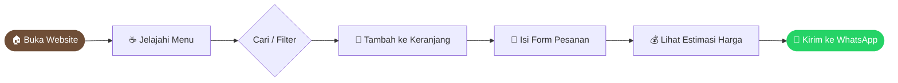

<div align="center">


<a href="https://kopi-banuaqu.vercel.app/">
  
</a>

<br/>

[](https://kopi-banuaqu.vercel.app/)
[](https://github.com/Taquthh/kopi-banuaqu)


**[🚀 Lihat Demo](https://kopi-banuaqu.vercel.app/)** · **[📂 Source Code](https://github.com/Taquthh/kopi-banuaqu)** · **[🐛 Laporkan Masalah](https://github.com/Taquthh/kopi-banuaqu/issues)**

</div>

---

## 📖 Tentang Proyek

**Kopi Banua** adalah landing page untuk UMKM kopi yang dibuat sebagai **Tugas 1 mata kuliah Pemrograman Web 1**, S1 Sistem Informasi, Fakultas Teknologi Informasi, UNISKA MAB.

Website ini dibangun dengan **HTML, CSS, dan JavaScript murni** (tanpa framework) dan menghadirkan pengalaman belanja yang lengkap, mulai dari melihat menu, memasukkan ke keranjang, sampai checkout langsung ke WhatsApp penjual.

---

## ✨ Fitur Unggulan

<table>
<tr>
<td width="50%" valign="top">

### 🧭 Navigasi Pintar

- Navbar lengket (_sticky_)
- Menu hamburger untuk mobile
- _Scrollspy_ menandai bagian aktif
- Bilah progres baca

### 🎨 Tampilan & Interaksi

- 🌗 Mode gelap/terang (tersimpan)
- ⌨️ Efek mengetik (_typewriter_)
- 🔢 Angka berhitung animasi
- 🕒 Status **buka/tutup real-time** (WITA)

</td>
<td width="50%" valign="top">

### 🛍️ Belanja Mudah

- Menu dengan **pencarian** dan **filter**
- Keranjang belanja
- **Checkout via WhatsApp**
- Form pesanan dengan validasi
- Estimasi harga otomatis

### 🖼️ Konten Visual

- Galeri dengan _lightbox_
- Video proses sangrai
- Slider testimoni
- Peta lokasi interaktif

</td>
</tr>
</table>

<details>
<summary><b>📋 Lihat daftar fitur lengkap</b></summary>

<br/>

| No  | Fitur        | Keterangan                                                      |
| :-: | ------------ | --------------------------------------------------------------- |
|  1  | Navigasi     | Lengket, menu hamburger, scrollspy, progres baca                |
|  2  | Tema         | Mode gelap/terang yang tersimpan                                |
|  3  | Animasi      | Efek ketik, status buka/tutup real-time (WITA), angka berhitung |
|  4  | Menu         | Pencarian, filter, keranjang, checkout WhatsApp                 |
|  5  | Galeri       | Lightbox, video sangrai, slider testimoni                       |
|  6  | Form Pesanan | Validasi, estimasi harga, kirim ke WhatsApp                     |
|  7  | Lokasi       | Peta Komplek Griya Annisah, Handil Bakti, Barito Kuala          |

</details>

---

## 🔄 Alur Pemesanan



---

## 🛠️ Teknologi

| Teknologi                                                                                      | Kegunaan                       |
| ---------------------------------------------------------------------------------------------- | ------------------------------ |
|                 | Struktur halaman               |
|                    | Styling, tema, dan animasi     |
|  | Interaksi, keranjang, validasi |
|                              | Hosting dan deployment         |
|                              | Version control                |

---

## 📁 Struktur Proyek

```text
kopi-banuaqu/
├── 📄 index.html        # Halaman utama
├── 📂 css/
│   └── 🎨 style.css     # Seluruh gaya dan tema
├── 📂 js/
│   └── ⚙️ script.js     # Logika interaksi
├── 📂 img/              # Aset gambar
└── 📂 dokumentasi/      # Dokumentasi tugas
```

---

## 🚀 Menjalankan Secara Lokal

```bash
# 1. Clone repositori
git clone https://github.com/Taquthh/kopi-banuaqu.git

# 2. Masuk ke folder
cd kopi-banuaqu

# 3. Buka index.html di browser
#    atau gunakan Live Server (VS Code) agar auto-reload
```

> 💡 **Tip:** Tidak perlu instalasi apa pun. Cukup buka `index.html` di browser.

---

## 👨‍💻 Pembuat

<div align="center">

|                   |                                          |
| :---------------- | :--------------------------------------- |
| **Nama**          | Quthbi Nor Fadillah                      |
| **NPM**           | 2510020089                               |
| **Program Studi** | S1 Sistem Informasi                      |
| **Kampus**        | Fakultas Teknologi Informasi, UNISKA MAB |
| **Mata Kuliah**   | Pemrograman Web 1                        |

[](https://github.com/Taquthh)

</div>

---

<div align="center">

**Dibuat dengan ☕ dan ❤️ di Banua**

⭐ Jika proyek ini bermanfaat, beri bintang di GitHub!


</div>
